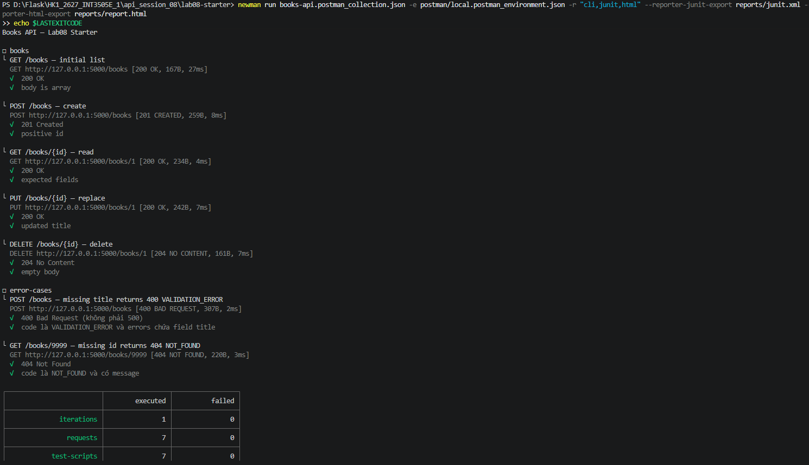
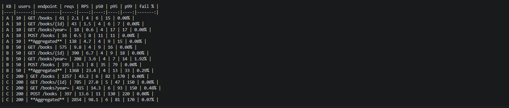

# BÁO CÁO KẾT QUẢ THỰC HÀNH – API TESTING & PERFORMANCE

## Lab 2 – Kiểm thử hợp đồng API với Spectral & Pytest

### 1. Các lệnh thực thi
```powershell
spectral lint openapi.orig.yaml --ruleset .spectral.yml | Tee-Object -FilePath reports/spectral_before.log
spectral lint openapi.yaml      --ruleset .spectral.yml | Tee-Object -FilePath reports/spectral.log
python -m pytest -v tests/test_contract_openapi.py
```

### 2. Tóm tắt kết quả
- **Lần 1 (`openapi.orig.yaml`):** Phát hiện **16 problems** (`2 errors`, `14 warnings`), bắt đúng các lỗi thiết kế ban đầu:
  - Thiếu `operationId` tại `paths./books.get` (dòng 24).
  - Khai báo body cho mã phản hồi `204 No Content` tại `paths./books/{id}.delete` (dòng 95).
  - Kiểu dữ liệu của `year` trong schema `Book` đang là `string` thay vì `integer` (dòng 110).
- **Lần 2 (`openapi.yaml`):** `0 errors, 0 warnings` (sạch lỗi).
- **Pytest (`test_contract_openapi.py`):** Tất cả test case đều `PASSED`.

### 3. Minh chứng (Hình ảnh)
*(Gợi ý: Trong VS Code, bạn có thể nhấn `Ctrl + V` trực tiếp vào từng mục dưới đây để dán ảnh chụp màn hình)*

- **Ảnh 2.1 – Output 2 lệnh Spectral (`spectral_before.log` và `spectral.log`):**
  

- **Ảnh 2.2 – Nội dung cấu hình `.spectral.yml` và kết quả chạy `pytest` (`tests/test_contract_openapi.py`):**
  

---

## Lab 3 – Kiểm thử tự động API với Postman & Newman

### 1. Các lệnh thực thi
- **Terminal 1 (Khởi chạy API Server):**
  ```powershell
  python -m app --port 5000
  ```
- **Terminal 2 (Chạy Newman & xuất báo cáo):**
  ```powershell
  newman run books-api.postman_collection.json -e postman/local.postman_environment.json -r cli,junit,html --reporter-junit-export reports/junit.xml --reporter-html-export reports/report.html
  echo $LASTEXITCODE
  ```

### 2. Tóm tắt kết quả
- **Tổng số request:** `7/7` thành công (✓).
- **Tổng số assertions:** `14/14` passed (`0` failed).
- **Mã thoát (`$LASTEXITCODE`):** `0`.
- **Tổng thời gian chạy:** `[Điền thời gian, VD: 1.2s]` (< 10 giây).

### 3. Minh chứng (Hình ảnh)


---

## Lab 4 – Kiểm thử hiệu năng với Locust

### 1. Lệnh thực thi
```powershell
powershell -ExecutionPolicy Bypass -File performance/run_scenarios.ps1
```

### 2. Bảng tổng hợp số liệu các kịch bản (A, B, C)
*(Điền số liệu tương ứng với file `performance/analysis.md` của bạn)*

| Kịch bản | Số Users | Tổng Requests | RPS (req/s) | Median (ms) | p95 (ms) | p99 (ms) | Tỷ lệ lỗi (%) |
| :--- | :---: | :---: | :---: | :---: | :---: | :---: | :---: |
| **Scenario A** | `[điền]` | `[điền]` | `[điền]` | `[điền]` | `[điền]` | `[điền]` | `[điền]` |
| **Scenario B** | `[điền]` | `[điền]` | `[điền]` | `[điền]` | `[điền]` | `[điền]` | `[điền]` |
| **Scenario C** | `[điền]` | `[điền]` | `[điền]` | `[điền]` | `[điền]` | `[điền]` | `[điền]` |

### 3. Minh chứng (Hình ảnh)

- **Ảnh 4.1 – Bảng thống kê cuối của 3 kịch bản A, B, C trên Terminal:**
  
